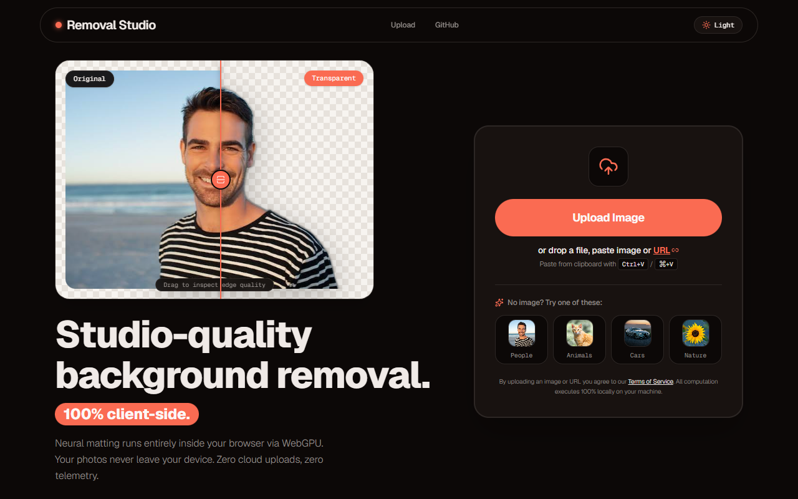
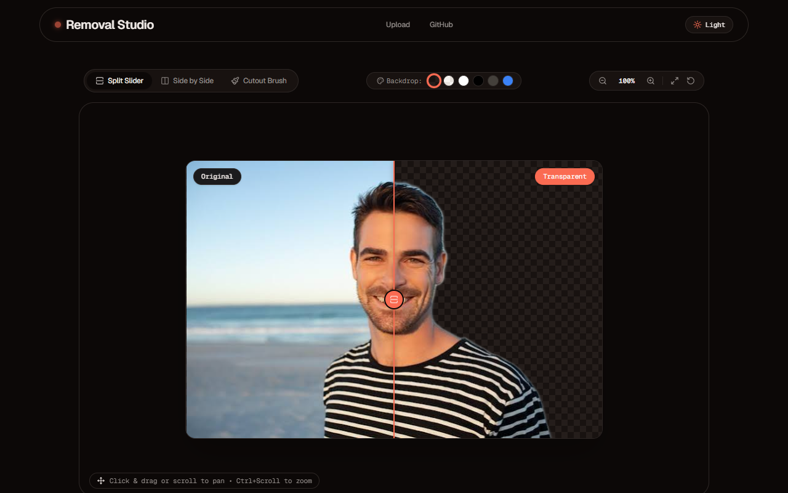

# Removal Studio

Free, open-source background remover that runs entirely in your browser. No uploads, no accounts, no limits.





Your image is processed on your own device with [`@imgly/background-removal`](https://github.com/imgly/background-removal-js) (ONNX Runtime, WebGPU with a WebAssembly fallback). Nothing is sent to a server.

## Features

- Drop, paste (Ctrl+V), pick a file, or load an image from a URL
- Before/after comparison slider
- Edge smoothing and halo decontamination to clean up hair and fine edges
- Brush tool to restore or erase parts of the cutout by hand
- Transparent PNG download or copy to clipboard
- Light and dark theme
- Input validation (file signature and size checks) before processing

## Run it

```bash
git clone https://github.com/laalaalaee/removal-studio
cd removal-studio
npm install
npm run dev        # http://localhost:3000
```

Other scripts: `npm run build`, `npm test`, `npm run lint`.

Or with Docker (serves the production build with nginx):

```bash
docker compose up --build   # http://localhost:8080
```

## How it works

1. The image is validated in the browser (magic bytes, dimensions).
2. A segmentation model runs locally through ONNX Runtime Web.
3. Post-processing (morphological cleanup, edge smoothing, decontamination) refines the mask in `src/services/postProcessing.ts`.
4. The brush editor in `src/services/brushCompositor.ts` lets you correct the mask before export.

The model files are downloaded once by the library on first use and cached by the browser.

## Stack

React 19, Vite, TypeScript, Tailwind CSS, Vitest.

## Notes

- The first run downloads the model, so it takes a bit longer than later runs.
- Large images use a lot of memory. Very high-resolution files may be slow on older devices.

## License

[MIT](LICENSE)
